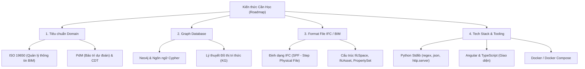

# Hướng Dẫn Onboarding & Kiến Trúc Dự Án ISO 19650 Knowledge Graph
> **Dành cho thành viên mới tham gia dự án (Giải thích theo phương pháp Feynman)**

---

## 1. Tổng Quan Dự Án (High-Level Overview)

### 🎯 Mục tiêu cốt lõi
Dự án nhằm tự động hóa việc kiểm tra tính sẵn sàng của mô hình thông tin công trình 3D (**BIM - Building Information Modeling** dạng file `.ifc`) cho bài toán **Bảo trì dự đoán (Predictive Maintenance - PdM)** trên hệ thống **Song sinh số nhận thức (Cognitive Digital Twin - CDT)**, dựa trên bộ tiêu chuẩn quốc tế **ISO 19650** (gồm 6 phần: 1, 2, 3, 4, 5, 6).

### 💡 Ẩn dụ trực quan (Feynman Metaphor)
* Hãy tưởng tượng **ISO 19650** là một "Bộ luật quốc tế" dài hàng nghìn trang PDF quy định cách xây dựng và quản lý dữ liệu tòa nhà.
* **Vấn đề:** Máy tính không thể tự đọc file PDF để "điều tra" file 3D tòa nhà (`.ifc`) xem các kỹ sư thiết kế có tuân thủ đúng quy định hay không.
* **Giải pháp của dự án:**
  1. Chuyển toàn bộ "cuốn sách PDF" này thành một **Đồ thị tri thức (Knowledge Graph - KG)** chứa **388 Nodes (Khái niệm)** và **1,094 Relationships (Mối quan hệ)** mà máy tính có thể truy vấn.
  2. Rút ra **13 Quy tắc cốt lõi (13 IFC Requirements)** dành cho bài toán Bảo trì dự đoán (PdM).
  3. Xây dựng một **Thanh tra tự động (IFC Checker)**: Nhập file 3D `.ifc` vào, công cụ sẽ quét và chấm điểm: **CDT-READY** (Đạt chuẩn Song sinh số), **CONDITIONAL** (Tạm đạt), hay **NOT READY** (Không đạt), kèm theo số điều khoản (Clause) dẫn chứng trong tiêu chuẩn ISO.

---

## 2. Sơ Đồ Kiến Trúc & Quy Trình Workflow (5 Bước)

```
[1. ISO PDFs] ──(Trích xuất)──▶ [2. 6 File JSON KG] ──(5 Cổng Gate)──▶ [3. Verified KG]
                                                                              │
               ┌──────────────────────────────┬───────────────────────────────┼──────────────────────────────┐
               ▼                              ▼                               ▼                              ▼
      [4a. Nạp vào Neo4j DB]      [4b. Tạo 13 IFC Rules]           [4c. Chạy Audit Engine]         [5. Angular Web UI]
   (docker/export_neo4j.py)        (gen_pdm_spec.py)                (check_ifc_pdm.py)               (Trực quan hóa)
```

### Chi tiết 5 Bước trong Workflow:

1. **Bước 1: Trích xuất Tri thức (Extraction & Curation)**
   * **File liên quan:** `backend/extraction/draft_extractor.py`
   * **Chức năng:** Trích xuất tự động các thuật ngữ, định nghĩa từ file PDF tiêu chuẩn ra dạng JSON. Kết hợp kiểm duyệt thủ công (Curation) để tạo thành 6 file JSON lưu tại `data/iso19650-*_extraction*.json`.

2. **Bước 2: Kiểm định chất lượng Đồ thị (Machine Verification / 5 Gates)**
   * **File liên quan:** `backend/gates/evaluate_kg.py`
   * **Chức năng:** Đảm bảo dữ liệu đồ thị chuẩn xác 100% qua 5 cổng gác tự động:
     * **E1 (Structure):** Không chứa ID trùng lập, không rỗng, đúng định dạng ASCII.
     * **E2 (Fidelity):** Trích xuất chính xác từng từ nguyên văn định nghĩa trong Clause 3.
     * **E3 (References):** 1,486 trích dẫn điều khoản (Clause provenance) phải tồn tại trong bộ tiêu chuẩn.
     * **E4 (Traversability):** Đồ thị liên thông, có "xương sống" 16 bước PdM.
     * **E5 (Coverage):** Bao phủ đủ 100% khái niệm cốt lõi.

3. **Bước 3: Nạp Đồ thị & Tạo Bộ quy tắc (Neo4j DB & Requirement Spec)**
   * **File liên quan:** `backend/graphdb/export_neo4j.py` & `backend/spec/gen_pdm_spec.py`
   * **Chức năng:**
     * Chuyển các file JSON thành file Cypher `data/generated/load_iso19650_kg.cypher` và nạp vào Neo4j Graph DB.
     * Tự động sinh ra bộ 13 quy tắc kiểm tra mô hình IFC lưu tại `data/generated/pdm_ifc_requirements.json`.

4. **Bước 4: Động cơ Kiểm tra Mô hình BIM (`check_ifc_pdm.py`)**
   * **File liên quan:** `backend/audit/check_ifc_pdm.py`
   * **Chức năng:** Phân tích cú pháp (parse) cấu trúc file `.ifc`, kiểm tra sự tồn tại của các thông tin như định danh không gian, thuộc tính thiết bị, thông tin bảo trì... Trả về kết quả đánh giá (PASS/FAIL) kèm dẫn chứng ISO.

5. **Bước 5: Giao diện Web UI (Angular + Python Backend)**
   * **File liên quan:** `frontend/` & `backend/api/serve.py`
   * **Chức năng:** Cung cấp 5 tab làm việc: Kiểm tra file IFC (Check IFC), Xem 13 quy tắc & lý do (Requirements & why), Khám phá đồ thị tương tác (Explore graph), Xem báo cáo chính xác (Method & accuracy), và Chính sách riêng tư (Policies & privacy).

---

## 3. Lộ Trình Kiến Thức Dành Cho Thành Viên Mới (Roadmap)



---

## 4. Các Lệnh Thao Tác Thường Dùng (Cheat Sheet)

### 🐋 Docker Environment (Khuyên dùng)
```powershell
# 1. Khởi động hệ thống (Web UI :8000 & Neo4j Browser :7474)
docker compose up -d --build

# 2. Nạp Đồ thị tri thức vào Neo4j (Chạy 1 lần đầu)
docker compose exec neo4j cypher-shell -u neo4j -p changeme-please -f /import/load_iso19650_kg.cypher

# 3. Kiểm tra số lượng Node trong Neo4j (Kết quả phải đúng 388)
# Chạy câu lệnh Cypher: MATCH (n:Iso19650) RETURN count(n)
```

### 🐍 Local Python Toolchain (Bare Metal)
```powershell
# 1. Khởi động Web Backend & Frontend tích hợp
python3 backend/api/serve.py

# 2. Kiểm tra tính toàn vẹn 5 Cổng (5 Gates) của Đồ thị
python3 backend/gates/evaluate_kg.py

# 3. Chạy audit 1 file IFC cụ thể
python3 backend/audit/check_ifc_pdm.py path/to/your_model.ifc --json report.json

# 4. Sinh lại bộ quy tắc 13 Requirements khi KG thay đổi
python3 backend/spec/gen_pdm_spec.py
```

---

## 5. Các Lưu Ý Quan Trọng Về Bảo Mật & Dữ Liệu

1. **Không push file tiêu chuẩn PDF:** Các file tiêu chuẩn trong thư mục `1. ISO 19650 Series/` có bản quyền thương mại. Không bao giờ được commit lên GitHub.
2. **Không commit file JSON trích xuất gốc & Cypher:** File `iso19650-*_extraction*.json` và `load_iso19650_kg.cypher` chứa nội dung trích xuất nguyên văn, chỉ lưu hành nội bộ dự án.
3. **Backend không dùng thư viện ngoài (`pip install`):** Backend viết 100% bằng thư viện tiêu chuẩn Python (stdlib) nhằm đảm bảo tốc độ khởi động cực nhanh và không bị phụ thuộc xung đột dependency.
